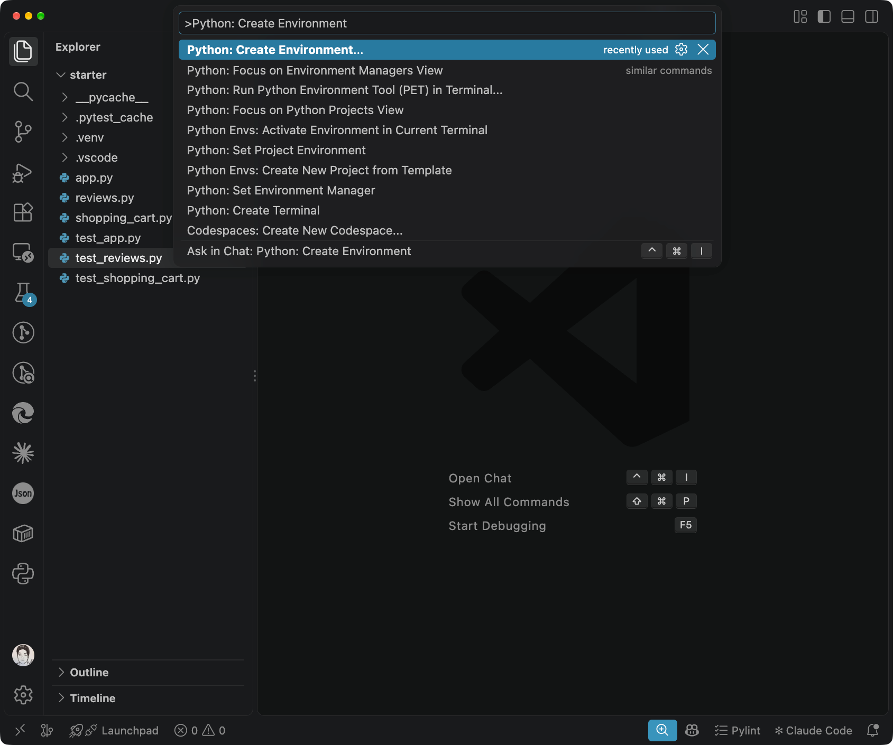
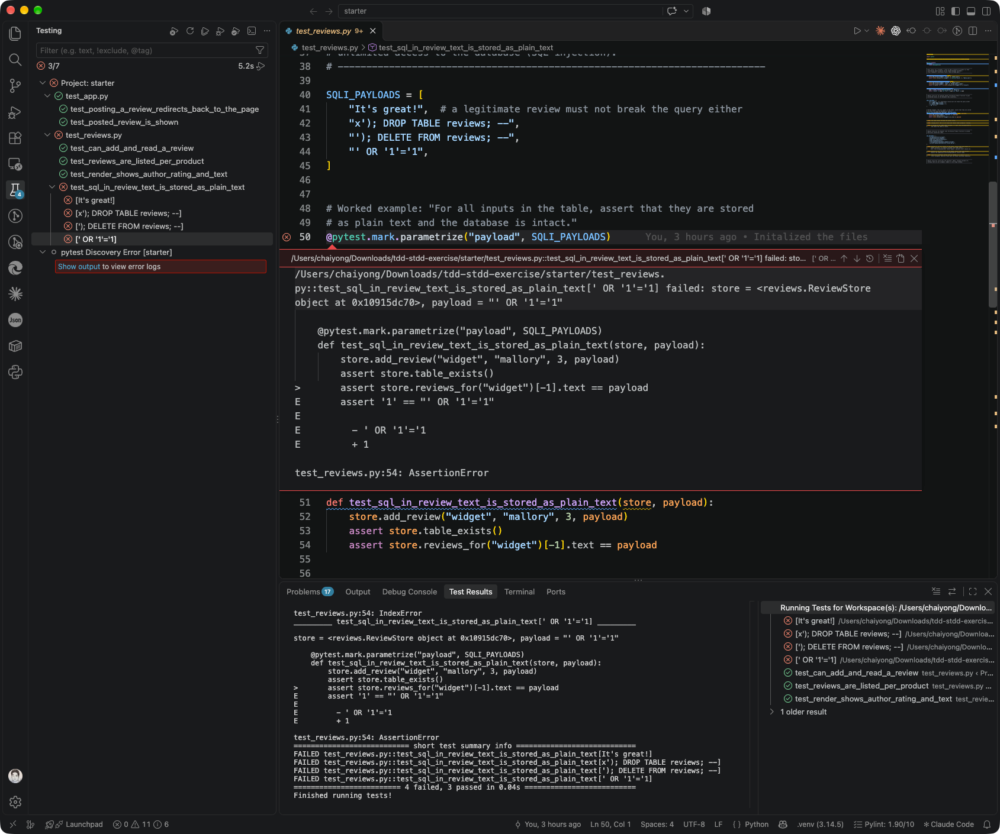
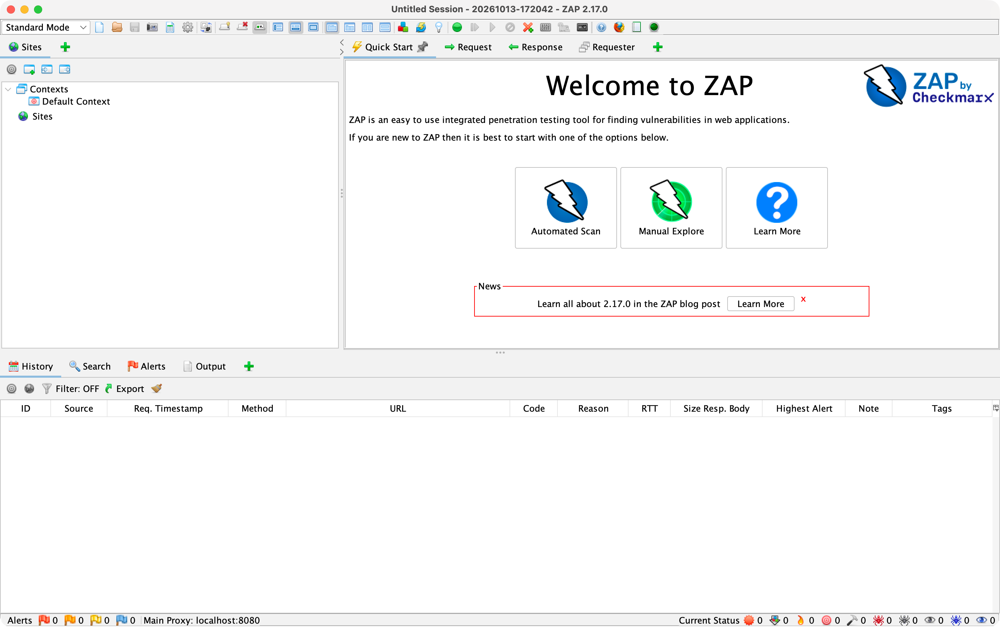

# ITCY 553 Lab: TDD and Security TDD (STDD) in Python

In this lab you will write **tests first, code second**. This way of working is called **Test-Driven Development (TDD)**. You will then use the same idea to find and fix **security holes** in a small web app. Along the way you will use a tool that looks for security problems automatically.

You do **not** need to be an expert programmer. Every step tells you what to type and what you should see. If a word is new to you, look it up in [Key words](#key-words).

| Part | What you do | Time | Files you work on |
|------|-------------|------|-------------------|
| 1 | Practise TDD by building a shopping cart | 45 min | `shopping_cart.py`, `test_shopping_cart.py` |
| 2 | Find and fix security holes in a product review feature | 75 min | `reviews.py`, `test_reviews.py` |
| 3 *(optional)* | Test and scan the review web page | 45 min | `app.py`, `test_app.py` |

Parts 1 and 2 are required. **Part 3 is optional**: it is more technical, and it is for students who finish early or want a challenge. You can skip every section marked *optional*.

**Learning outcomes.** By the end of the lab you can:

1. Write a failing test before you write any code, then write only enough code to make it pass.
2. Think like an attacker: turn a normal feature description (a user story) into attack descriptions (abuser stories), and turn those into tests.
3. Use the results of a security scanning tool to decide which tests to write.
4. Fix security holes without breaking what the program already does.

### How to use this guide

- Work through the sections **in order**. Each part builds on the one before.
- Text in a grey box like `pytest -q` is something you type into the **terminal**, then press Enter. Text after `#` on a command line is a comment for you to read; you do not need to type it.
- Sections marked **▶ Hint** are hidden. Click them only when you are stuck.
- If something goes wrong, check [When something goes wrong](#when-something-goes-wrong) first.

---

## Key words

You do not need to learn these by heart. Come back here when you meet a word you do not know.

| Word | What it means |
|------|---------------|
| **Terminal** | A window where you type commands instead of clicking. On macOS open the *Terminal* app; on Windows open *PowerShell*; in VS Code use *Terminal → New Terminal*. |
| **Folder / `cd`** | `cd starter` means "change directory (folder) into `starter`". Commands work on the files in the folder you are currently in. |
| **Package** | Ready-made code written by someone else that you install, for example `pytest` or `flask`. `pip install` downloads packages. |
| **Virtual environment (`.venv`)** | A private folder of packages just for this lab, so it does not mix with other projects. You **activate** it each time you open a new terminal. |
| **Test** | A small function that runs your code and checks the result. If the check is wrong, the test **fails**. |
| **`assert`** | The check inside a test. `assert 2 + 2 == 4` passes; `assert 2 + 2 == 5` fails. `==` means "is equal to". |
| **pytest** | The tool that finds your tests, runs them and reports which pass and which fail. |
| **TDD log** | A table you hand in, with one row for every Red → Green cycle: the test you wrote, its failure message, the code you changed to make it pass, and any tidying up. |
| **Red → Green → Refactor** | The TDD cycle. **Red:** write a test that fails. **Green:** write the smallest code that makes it pass. **Refactor:** tidy the code while keeping every test passing. |
| **Exception / error** | Python's way of saying something went wrong, for example `ValueError`. Code can *raise* one on purpose to reject bad input. |
| **Fixture** | Set-up code that pytest runs for you before a test, for example creating an empty database. |
| **User story / abuser story** | A user story describes what a normal user wants. An abuser story describes what an **attacker** wants to do with the same feature. |
| **Payload** | The text an attacker types in to attack the program, for example `<script>alert(1)</script>`. |
| **SQL / database** | The program stores reviews in a database. SQL is the language used to talk to it (`INSERT` to save, `SELECT` to read). |
| **SQL injection** | An attack where text typed by a user is treated as an SQL command, so the attacker can read or delete data. |
| **XSS (cross-site scripting)** | An attack where text typed by a user ends up in a web page as code, so the browser runs the attacker's JavaScript. |
| **Escaping** | Changing special characters so they are shown as text, not run as code. `<` becomes `&lt;`. |
| **SAST** | *Static* testing: a tool reads your source code without running it. In this lab: **Bandit**. |
| **DAST** | *Dynamic* testing: a tool attacks your program while it is running. In this lab: **OWASP ZAP**, used only in the optional Part 3. |
| **HTTP status code** | A number a web server sends back with every page. `200` OK, `303` go to another page, `400` you sent bad data, `500` the server crashed. |
| **Header** | Extra information that comes with a web page. Some headers tell the browser to turn on security protections. |
| **localhost / port** | `localhost` means "this computer". A port is like a door number; the lab app uses door `8000`, so its address is `http://localhost:8000`. |

---

## Setup

Do this **before** the lab if you can. Installing everything can take 20 to 30 minutes.

### Step 0: Get Python and the lab files

1. **Check that Python is installed.** Open a terminal and type:

   ```bash
   python3 --version       # Windows: py --version
   ```

   You should see `Python 3.9` or a higher number. If you see an error, or a lower number, download Python from <https://www.python.org/downloads/>. On Windows, tick **Add python.exe to PATH** on the first screen of the installer.

2. **Get the lab files.** On the GitHub page of this lab, click the green **Code** button → **Download ZIP**, then unzip it. (If you know Git, `git clone` works too.) Inside you will find this `README.md`, `requirements.txt` and a folder called `starter`. **All your work happens in `starter`.**

Now choose **one** way to set up: **Option A** if you are happy typing commands, or **Option B** if you prefer clicking in VS Code. Both create the same `.venv` folder inside `starter/`, so you can switch later.

### Option A: Command line

Open a terminal **in the unzipped lab folder** and type these lines one at a time. What each line does is written after the `#`.

```bash
cd starter                         # go into the starter folder
python3 -m venv .venv              # create the virtual environment (Windows: py -m venv .venv)
source .venv/bin/activate          # turn it on (Windows: .venv\Scripts\activate)
pip install -r ../requirements.txt # install pytest, flask and bandit
pytest -q                          # run the tests
```

After the `activate` line, your prompt should start with `(.venv)`. **Every time you open a new terminal**, you must `cd` into `starter` and run the `activate` line again.

The last command, `pytest -q`, stops with `ImportError: cannot import name 'Product'`. **That is expected.** It is the starting point of Part 1.

Other ways to run tests:

| Command | What it does |
|---------|--------------|
| `pytest -q test_shopping_cart.py` | Run only the tests in one file |
| `pytest -q -k new_cart` | Run only tests whose name contains `new_cart` |

### Option B: VS Code (GUI)

1. Install [VS Code](https://code.visualstudio.com) and the **Python** extension by Microsoft. To find the extension, click the *Extensions* icon on the left (or press `Ctrl+Shift+X` / `Cmd+Shift+X`) and search for "Python".
2. Choose *File → Open Folder…* and open the **`starter`** folder, not the folder above it. If VS Code asks whether you trust the authors, click *Yes, I trust the authors*.
3. Open the **Command Palette** with `Ctrl+Shift+P` (Windows) or `Cmd+Shift+P` (macOS). Type **Python: Create Environment** and press Enter. Choose **Venv**, then choose Python 3.9 or newer. VS Code creates the `.venv` folder and starts using it. If it asks about `requirements.txt`, skip that question; you will install the packages in the next step.

   

4. Open a terminal inside VS Code with *Terminal → New Terminal*. The prompt should start with `(.venv)`. Type:

   ```bash
   pip install -r ../requirements.txt
   ```

5. Click the **Testing** icon (it looks like a beaker 🧪) on the left. The lab is already set up for pytest, so the tests should appear by themselves. If you see a *Configure Python Tests* button instead, click it, then choose **pytest**, then **`.` (root directory)**.
6. The tests appear in a tree. Click ▷ at the top to run all tests, or the ▷ next to one file or one test to run only that. You can also click the ▷ next to any `def test_...` line in the editor.

   

A **red ✗** means a test failed and a **green ✓** means it passed: this is the Red → Green cycle you write down in your TDD log. Click a failed test to see why it failed. To run a test line by line, click just left of a line number to set a red dot (a *breakpoint*), then right-click the test and choose *Debug Test*.

If the tests do not appear, or you want to run the Flask app from VS Code in the optional Part 3, see [VSCODE.md](VSCODE.md).

### Setting up Bandit (SAST)

[Bandit](https://bandit.readthedocs.io) reads Python code and warns you about lines that look unsafe. It was already installed by `pip install` above. Check that it works (make sure your prompt shows `(.venv)` and you are in `starter`):

```bash
bandit --version                   # should print "bandit 1.7.5" or a higher number
bandit reviews.py app.py           # scan the two application files
```

The scan should report **two** issues called **B608** (possible SQL injection) in `reviews.py`, on lines 33 and 39. That is expected: you will fix them in Part 2.

If you see `bandit: command not found`:

- Your virtual environment is probably not active. Your prompt should start with `(.venv)`. If it does not, run `source .venv/bin/activate` again (Windows: `.venv\Scripts\activate`).
- Or install Bandit on its own: `pip install "bandit>=1.7.5"`.
- Or run it through Python: `python -m bandit reviews.py app.py`.

Useful options:

| Command | What it does |
|---------|--------------|
| `bandit reviews.py app.py` | Scan these two files |
| `bandit -r . -x ./.venv -s B101` | Scan the whole folder, but skip the `.venv` folder and skip warning B101 (Bandit warns about every `assert`, which is normal in test files) |
| `bandit -ll reviews.py` | Show only medium and high severity issues (`-lll` for high only) |
| `bandit -f html -o bandit-before.html reviews.py app.py` | Save the results as a web page. Use this for the "before" and "after" results in your report |

### Setting up OWASP ZAP (DAST) *(optional)*

> **Skip this section** unless you plan to do the optional Part 3.

[ZAP](https://www.zaproxy.org) attacks a **running** website to find security problems. If you plan to do Part 3, install it **before** the lab, because the download is large (about 250 MB).

Download ZAP from <https://www.zaproxy.org/download/> and follow the steps for your computer.

**macOS**

1. Check which chip your Mac has: Apple menu → *About This Mac*. If it says *Apple M1/M2/M3…*, download **macOS (Apple Silicon)**. If it says *Intel*, download **macOS (Intel)**. Both already include Java, so you do not need to install it.
2. Open the downloaded `.dmg` file and drag *ZAP* into *Applications*.
3. The first time you open ZAP, macOS says *"ZAP" cannot be opened because the developer cannot be verified*. This is normal for ZAP. Click *Done*, open *System Settings → Privacy & Security*, scroll down and click *Open Anyway* next to the message about ZAP.



If you use Homebrew, `brew install --cask zap` does steps 1 and 2 for you.

**Windows**

1. ZAP needs **Java 17 or newer**. Open PowerShell and type `java -version`. If you get an error, or the number is lower than 17, install *Temurin 17 (LTS)* or newer from <https://adoptium.net>. Then close PowerShell, open a **new** one and check again.
2. Download the **Windows (64) Installer** and run it. If Windows says *Windows protected your PC*, click *More info → Run anyway*. This warning is normal for ZAP.
3. Click through the installer with the default options. Start ZAP from the Start menu.

Alternatively, `winget install --id=ZAP.ZAP -e` installs ZAP, but you still need Java 17 or newer.

**Linux**

1. Install Java 17 or newer, for example `sudo apt install openjdk-17-jre` on Ubuntu or Debian. Check with `java -version`.
2. Install ZAP with `sudo snap install zaproxy --classic`, or download the **Linux Installer** (`.sh` file) and run `bash ZAP_*_unix.sh`.
3. Start ZAP from your applications menu, or type `zaproxy` if you used snap.

**First start (all computers)**

1. ZAP asks whether to *persist* (save) the session. Choose *No, I do not want to persist this session*, then click *Start*.
2. If ZAP offers to update add-ons, click yes. It takes about a minute.
3. You should see the *Quick Start* tab with an *Automated Scan* button, as in the picture above. ZAP is ready.

If ZAP does not start on Windows or Linux, the usual reason is an old Java. Run `java -version` and check that it says 17 or higher.

> ⚠️ Only scan programs that you run yourself, such as the lab app on `localhost`. Scanning other people's websites without permission may be illegal.

---

## Project walkthrough

Read this before Part 1. It explains what each file does, how the tests work, and what you should see the first time you run them. It does **not** tell you how to fix anything: that is the lab.

### The files

```
starter/
├── shopping_cart.py        Part 1: empty, you build it with TDD
├── test_shopping_cart.py   Part 1: one test written for you
├── reviews.py              Part 2: saves reviews and turns them into a web page (has security holes)
├── test_reviews.py         Part 2: tests that already pass, plus lists of attack inputs
├── app.py                  Part 3 (optional): the web page, built with Flask
├── test_app.py             Part 3 (optional): tests for the web page
└── .vscode/                VS Code settings (see VSCODE.md)
```

Each code file has a test file with the same name plus `test_` in front. pytest automatically finds every file whose name starts with `test_`, and runs every function inside it whose name starts with `test_`.

The parts are connected. `app.py` uses `reviews.py`, so when you fix `reviews.py` in Part 2, the web page in Part 3 becomes safer too.

```
browser ──request──▶ app.py ──calls──▶ reviews.py ──SQL──▶ database (in memory)
                       ▲                   ▲
                  test_app.py         test_reviews.py
```

### Part 1 files: `shopping_cart.py` and `test_shopping_cart.py`

`shopping_cart.py` contains only a comment. There is no code yet, on purpose.

`test_shopping_cart.py` starts like this:

```python
from shopping_cart import Product, ShoppingCart

# Requirement 1: a new shopping cart is empty
def test_new_cart_is_empty():
    cart = ShoppingCart()
    assert len(cart.products) == 0
```

Read it line by line:

- `from shopping_cart import Product, ShoppingCart` loads two **classes** (blueprints for objects) from `shopping_cart.py`. They do not exist yet, so this line fails. That is your first **Red**.
- `def test_new_cart_is_empty():` starts a test. `def` creates a function; the name says what should be true.
- `cart = ShoppingCart()` makes a new, empty shopping cart and calls it `cart`.
- `assert len(cart.products) == 0` checks that the cart contains zero products. `len(...)` counts the items in a list.

The rest of the file is comments that mark where your tests for Requirements 2 to 5 go.

### Part 2 files: `reviews.py` and `test_reviews.py`

**The code.** `reviews.py` saves product reviews in a small database and turns them into HTML (the language of web pages). It contains:

| Name | What it is |
|------|------------|
| `ValidationError` | An error for rejecting bad input. It exists but is **never used** yet. You will use it. |
| `Review` | Holds one review: `author`, `rating` and `text`. Two reviews with the same values count as equal, which keeps the tests short. |
| `ReviewStore` | Talks to the database. `ReviewStore()` creates a brand-new, empty database in memory, so every test starts with nothing in it. |
| `render_reviews(reviews)` | Turns a list of reviews into HTML: a `<ul>` list with one `<li>` line per review. |

What a `ReviewStore` can do:

| Method | What it does |
|--------|--------------|
| `add_review(product, author, rating, text)` | Saves one review. |
| `reviews_for(product)` | Gives back all reviews for one product, oldest first. |
| `table_exists()` | Says `True` if the reviews table is still in the database. Tests use it to check that an attack did not delete the table. |

Open `reviews.py` and look at `add_review`, `reviews_for` and `render_reviews`. Ask yourself: **how does the text that a user types end up inside the SQL command, or inside the HTML?** That question is the heart of Part 2.

**The tests.** Now open `test_reviews.py` (the **test** file, not `reviews.py`). It is split into blocks by long comment lines made of dashes (`# -------…`), each followed by a comment saying what the block is about.

1. **A fixture.**

   ```python
   @pytest.fixture
   def store():
       return ReviewStore()
   ```

   Any test that has `store` in its brackets automatically gets a new, empty `ReviewStore`. So tests never see each other's data.

2. **The teammate's tests.** Three tests check the normal feature: you can add a review and read it back, reviews are kept per product, and the HTML shows the author, rating and text. These pass now, and they must **still pass** after your fixes.

3. **Abuser story A2 (SQL injection).** A list of attack inputs and one test that tries each of them:

   ```python
   SQLI_PAYLOADS = [
       "It's great!",
       "x'); DROP TABLE reviews; --",
       ...
   ]

   @pytest.mark.parametrize("payload", SQLI_PAYLOADS)
   def test_sql_in_review_text_is_stored_as_plain_text(store, payload):
       store.add_review("widget", "mallory", 3, payload)
       assert store.table_exists()
       assert store.reviews_for("widget")[-1].text == payload
   ```

   `@pytest.mark.parametrize` runs the test **once for every item** in the list, putting the item into `payload` each time. So one function becomes four tests. pytest shows each one with its payload in square brackets:

   ```
   FAILED test_reviews.py::test_sql_in_review_text_is_stored_as_plain_text[It's great!]
   ```

   The test saves a review, then checks two things: the table still exists (the attack did no damage), and the last review (`[-1]` means "the last item") has exactly the text that was typed in. This is a **worked example**: copy its shape for the `TODO`s below it.

4. **Abuser story A1 (XSS).** Only a list of attack inputs (`XSS_PAYLOADS`) and `TODO` comments. You write these tests.

5. **Abuser story A3.** Empty. You choose an attack and write the tests.

### Part 3 files: `app.py` and `test_app.py` *(optional)*

You only need this if you do Part 3.

**The code.** `app.py` is a small website made with [Flask](https://flask.palletsprojects.com). It has one page, `/products/<product>/reviews`. The `<product>` part can be any word: `/products/widget/reviews` shows the reviews for "widget".

The page does two things:

| When the browser… | The app… |
|-------------------|----------|
| **GET**s the page (opens it) | Builds the HTML from `PAGE` and the reviews, and sends it back. |
| **POST**s the form (clicks *Post review*) | Reads `author`, `rating` and `text` from the form, saves the review, then sends status **303** to tell the browser to reload the page. |

Two details matter later:

- The app is made by a function, `create_app()`. Tests call it with their own empty `ReviewStore`, so each test starts clean. The last line, `app = create_app()`, is the app that `flask run` starts.
- The form says `type="number" min="1" max="5"`, but only the **browser** checks that. An attacker (or ZAP) can send any text they like straight to the server.

**The tests.**

```python
@pytest.fixture
def client(store):
    return create_app(store).test_client()

def post_review(client, author="alice", rating="5", text="Works well"):
    return client.post(URL, data={"author": author, "rating": rating, "text": text})
```

- `client` is a pretend browser. It sends requests straight to the app, so you do not need to start a server.
- `post_review` fills in the form for you. Change only the field your test is about, for example `post_review(client, rating="abc")`.
- What comes back (the **response**) has `.status_code` (such as `303` or `400`), `.data` (the page content as *bytes*, which is why tests write `b"Works well"` with a `b` in front) and `.headers`.

### What you should see on the first run

You can run the tests in the terminal or by clicking in VS Code. Both run the same pytest.

**Using the terminal** (inside `starter/`, with `(.venv)` active):

```bash
pytest -q
```

pytest stops at once with `ImportError: cannot import name 'Product'` and `Interrupted: 1 error during collection`. While one test file cannot load, pytest runs **no** tests at all. To look at the other parts before you start Part 1, name their files:

```bash
pytest -q test_reviews.py test_app.py
```

```
FAILED test_reviews.py::test_sql_in_review_text_is_stored_as_plain_text[It's great!]
FAILED test_reviews.py::test_sql_in_review_text_is_stored_as_plain_text[x'); DROP TABLE reviews; --]
FAILED test_reviews.py::test_sql_in_review_text_is_stored_as_plain_text['); DELETE FROM reviews; --]
FAILED test_reviews.py::test_sql_in_review_text_is_stored_as_plain_text[' OR '1'='1]
4 failed, 5 passed
```

The 5 passing tests are the normal-feature tests (3 in `test_reviews.py`, 2 in `test_app.py`). The 4 failures are the SQL injection example, one per attack input. **All of this is expected.**

**Using VS Code** (with the `starter` folder open, as in [Option B](#option-b-vs-code-gui)):

1. Click the **Testing** icon (the beaker 🧪) on the left.
2. Click ▷ (*Run Tests*) at the top of the Testing view.
3. Look at the tree:
   - `test_app.py` and `test_reviews.py` show the same results as the terminal: a **green ✓** on the 5 normal-feature tests and a **red ✗** on the 4 SQL injection tests. Click the arrow next to `test_sql_in_review_text_is_stored_as_plain_text` to see one entry per attack input.
   - `test_shopping_cart.py` is missing. Instead there is a **pytest Discovery Error** entry, because the file cannot load yet. Click *Show output* under it to see the `ImportError`. Unlike the terminal, VS Code still runs the other files.
4. Click any red ✗ test to see its failure message in the editor, as in the screenshot in [Option B](#option-b-vs-code-gui). The full pytest output is in the *Test Results* tab at the bottom.

### pytest cheat sheet

| Command | What it does |
|---------|--------------|
| `pytest -q` | Run all tests, short output |
| `pytest -q test_reviews.py` | Run one file |
| `pytest -q -k author` | Run tests whose name contains `author` |
| `pytest -q -x` | Stop at the first failure |
| `pytest -q --lf` | Run again only the tests that failed last time |
| `pytest -v` | Show the name of every test with PASSED or FAILED |

---

## Part 1: TDD warm-up (shopping cart)

You will build a shopping cart **one small test at a time**. `shopping_cart.py` is empty and the first test is written for you.

### The rules

- Never write code unless a failing test needs it.
- Write **one** test at a time. Run it and **see it fail** before you write code.
- Write the **simplest** code that makes the test pass, even if it looks silly (for example, `return 25`). The next test will force you to make it general.
- Tidy up (refactor) only when all tests pass, and run the tests again after every change.

### A worked example: your first cycle

Follow these steps exactly. They show you what TDD feels like.

**1. Red.** Run the test:

```bash
pytest -q test_shopping_cart.py
```

*In VS Code:* open the **Testing** view. `test_shopping_cart.py` does not appear in the tree yet; there is a **pytest Discovery Error** entry instead. Click *Show output* under it to read the error.

It fails with `ImportError: cannot import name 'Product' from 'shopping_cart'`. In plain words: *the test wants `Product` and `ShoppingCart`, and they do not exist.*

**2. Write the smallest code.** Add this to `shopping_cart.py`, under the comment, and save:

```python
class Product:
    pass


class ShoppingCart:
    pass
```

`pass` means "nothing here yet". Run the test again. (*In VS Code:* click *Refresh Tests* (⟳) at the top of the Testing view. `test_shopping_cart.py` now appears in the tree; click the ▷ next to `test_new_cart_is_empty`.) It still fails, but with a **different** message:

```
AttributeError: 'ShoppingCart' object has no attribute 'products'
```

That is progress: the classes exist now, but a cart has no `products`. Write each failure message down in your TDD log, one row per cycle.

**3. Green.** Replace the `ShoppingCart` class with:

```python
class ShoppingCart:
    def __init__(self):
        self.products = []
```

`__init__` runs whenever a new cart is made. `self.products = []` gives each new cart an empty list. Run the test again: `1 passed`. 🎉 **Green.**

**4. Refactor.** The code is tiny, so there is nothing to tidy. Move on.

You have now done one full cycle. Every other requirement works the same way: **write one test → see it fail → write just enough code → see it pass → tidy up.**

### Requirements

Now it is your turn. Write tests for these requirements, one at a time. Use exactly these names, because the instructor's tests will use them.

| # | Requirement | Names to use |
|---|-------------|--------------|
| R1 | A new shopping cart is empty | `ShoppingCart()`, `cart.products` |
| R2 | Products can be added to the cart. Code outside the cart must not be able to change `cart.products` directly. | `Product(name, price)`, `cart.add_product(p)` |
| R3 | The cart calculates the total price (an empty cart totals 0; prices with decimals such as 0.1 work) | `cart.total` |
| R4 | A product can be removed. Removing a product that is not in the cart raises `ValueError`. | `cart.remove_product(p)` |
| R5 | A product's price must not be negative (`ValueError`) | `Product("x", -1)` |

> **Think:** R5 looks like a normal business rule, but it is also a security rule. What could an attacker do if negative prices were allowed? Ask the same question about R2.

### How to write a test

Almost every test has three steps:

```python
def test_what_should_happen():
    # 1. Arrange: create the objects you need
    # 2. Act: do the one thing you are testing
    # 3. Assert: check the result with assert
```

Give each test a name that says what should be true, such as `test_new_cart_is_empty`.

**To test that code raises an error**, put the code inside `with pytest.raises(...)`. The test passes only if that error happens:

```python
with pytest.raises(ValueError):
    something_that_should_be_rejected()
```

**To compare decimal numbers**, use `pytest.approx`. Computers store decimals slightly inaccurately, so `0.1 + 0.2 == 0.3` is actually `False` in Python. `assert 0.1 + 0.2 == pytest.approx(0.3)` passes.

<details>
<summary>▶ Hint: ideas for small tests, in a good order</summary>

Each idea is one test. Write one, make it pass, then move to the next.

- R2: after adding one product, the cart contains that product.
- R2: after adding two products, the cart contains both, in order.
- R2: changing the list you get from `cart.products` does not change what is in the cart.
- R3: an empty cart has a total of 0.
- R3: a cart with one product has that product's price as its total.
- R3: a cart with several products adds their prices up, including decimal prices.
- R4: after removing a product, it is no longer in the cart.
- R4: removing a product that is not in the cart raises `ValueError`.
- R5: making a product with a negative price raises `ValueError`.
- R5: a price of exactly 0 is allowed (is it? decide, and test it).

</details>

**Checkpoint 1:** all tests pass, and your TDD log has at least 8 rows.

---

## Part 2: Security TDD (product reviews)

A teammate built a product review feature using TDD. All their tests pass, but they never thought about attackers. You will play the attacker, prove that the attacks work with tests, then fix the code.

### Background: the two attacks in this part

**SQL injection.** Imagine code that finds a user like this:

```python
query = f"SELECT * FROM users WHERE name = '{name}'"
```

The `f"..."` puts whatever is in `name` straight into the SQL command. If someone types their name as `x' OR '1'='1`, the command becomes:

```sql
SELECT * FROM users WHERE name = 'x' OR '1'='1'
```

`'1'='1'` is always true, so the database returns **every** user. The attacker's text has changed the meaning of the command. The fix is a **parameterised query**: put a `?` where the value goes and pass the value separately. The database then always treats it as plain text:

```python
conn.execute("SELECT * FROM users WHERE name = ?", (name,))
```

(The comma in `(name,)` is needed; it makes a list of one value.)

**XSS (cross-site scripting).** The review page puts each review's text into HTML. If someone writes the review `<script>alert(1)</script>`, the browser of **every visitor** runs that JavaScript. A real attacker would steal login cookies instead of showing an alert. The fix is **escaping**: Python's `html.escape("<script>")` gives `&lt;script&gt;`, which the browser shows as the text `<script>` instead of running it.

### The STDD loop

You will repeat this loop from the lecture:

```
scan with Bandit → write a security test → run it, see it FAIL (Red) →
fix the code safely → run all tests, see them PASS (Green) → tidy up → repeat
```

### Step 2.1: Scan the code (SAST)

```bash
bandit reviews.py app.py
```

For each issue, write down its ID (for example `B608`), the line number, the severity and the confidence. Look up what the ID means at <https://bandit.readthedocs.io>.

> Bandit tells you **where** the code looks risky. It does not prove that an attack really works. Your next job is to prove it with a test.

### Step 2.2: From user story to abuser stories

**User story:** *As a customer, I want to add a review of a product so that information about products can be shared between customers.*

Now think like an attacker. How could someone misuse this feature?

| ID | Abuser story | What to test |
|----|--------------|--------------|
| A1 | An attacker uses the review feature to spread malicious JavaScript (XSS). | (a) For every input in the list, check that the HTML output is escaped. (b) For every input in the list, check that the server rejects the review. |
| A2 | An attacker uses the review feature to take control of the database (SQL injection). | For every input in the list, check that it is saved as plain text and the database is not damaged. Looking up a product's reviews cannot be tricked into showing other products' reviews. |
| A3 | *Write this one yourself.* | *Write these yourself.* |

The lists `XSS_PAYLOADS` and `SQLI_PAYLOADS` are already in `test_reviews.py`. Use `@pytest.mark.parametrize` to run one test once for every item in a list. Here is how it works with a simple example:

```python
@pytest.mark.parametrize("word", ["apple", "banana", "cherry"])
def test_word_is_not_empty(word):
    assert len(word) > 0
```

pytest runs `test_word_is_not_empty` three times: once with `word = "apple"`, once with `"banana"` and once with `"cherry"`.

### Step 2.3: Red — prove the attacks work

The first security test, `test_sql_in_review_text_is_stored_as_plain_text`, is written for you. Run it:

```bash
pytest -q test_reviews.py
```

*In VS Code:* in the **Testing** view, click the ▷ next to `test_reviews.py`. After you add a new test and save the file, it appears in the tree by itself; if it does not, click *Refresh Tests* (⟳).

It fails for every input. Notice that even the **harmless** review `It's great!` fails. Why? (Hint: look at the `'` in `It's`.) A security bug is often a normal bug too.

Now write the other tests marked `TODO` in `test_reviews.py`. **Run each one and watch it fail before you fix anything.** Add each test to your TDD log.

To check that the code **rejects** an input, use `pytest.raises` with the error the code should raise:

```python
with pytest.raises(ValidationError):
    store.add_review(...)
```

<details>
<summary>▶ Hint: how do I check that the HTML is escaped?</summary>

Make a `Review` that contains the payload, pass it to `render_reviews`, and look at the result. The escaped version, `html.escape(payload)`, should be in the output, and the original payload should **not** be. Check both the review text and the author.

</details>

### Step 2.4: Green — fix the code

Change `reviews.py` following these secure-coding rules:

- **SQL injection:** use parameterised queries with `?`, as in the background example. Do not build SQL with `f"..."` or `+`. Do not use `executescript` with user input, because it runs **several** commands at once, which is what `DROP TABLE` attacks rely on. Use `execute` instead.
- **XSS, on output:** pass every value you put into HTML through `html.escape` (add `import html` at the top of the file). This protects the page even if bad data is already in the database.
- **XSS, on input:** reject reviews that contain HTML tags by raising `ValidationError` (`raise ValidationError("...")`). A harmless `<`, as in `2 < 3`, must still be accepted.
- **Input checks (A3):** decide on sensible limits (for example, which ratings are allowed and how long a review may be), write them down, and test the **boundary values**: the values just inside and just outside each limit, such as 0, 1, 5 and 6 for a 1-to-5 rating.

Your fixes **must not change normal behaviour**: the teammate's three original tests must still pass.

### Step 2.5: Scan again and tidy up

```bash
pytest -q && bandit reviews.py app.py
```

(The `&&` means "run the second command only if the first one succeeded".)

Both should now be clean: all tests pass and Bandit says `No issues identified`. If Bandit still reports something you believe is not a real problem (a *false positive*), explain why in your report. Do **not** hide it with `# nosec` unless you can justify it.

**Checkpoint 2:** every test passes, Bandit reports no issues, and you have at least 3 abuser stories with tests.

---

## Part 3 *(optional)*: The web form and DAST

> **This part is optional.** It is more technical than Parts 1 and 2. Do it if you have finished Part 2 and want a challenge. It earns bonus points (see the [grading rubric](#grading-rubric-100-points)).

`app.py` puts the review feature on a web page. Some problems only show up when the website is actually running, so in this part you also attack it with ZAP.

### Background: how the web page talks to the browser

1. The browser sends a **request**: "GET me this page" or "POST this form data".
2. The app sends back a **response** with a **status code**, some **headers** and the page itself.

| Status code | Meaning | When you will see it |
|-------------|---------|----------------------|
| `200` | OK | The page was shown |
| `303` | See other page | After posting a review, the browser is sent back to the review page |
| `400` | Bad request | The user sent bad data. **This is what your app should send for attacks.** |
| `500` | Server error | The code crashed. Users should never see this. |

### Step 3.1: Reject bad input sent through the form

Complete the `TODO` tests in `test_app.py`. If someone POSTs a review that contains a script, or a rating such as `abc` or `5); DROP TABLE reviews; --`, the app must answer with status **400** and must **not** save the review. Make each test fail first, then fix `app.py`.

Things to think about: what status code does the starter app return for `rating=abc` today? Why is a 500 error that shows the program's internal details a security problem?

<details>
<summary>▶ Hint: how do I send a 400 response in Flask?</summary>

Import `abort` from Flask (`from flask import Flask, abort, redirect, request`) and call `abort(400)`. It stops handling the request and sends a 400 response. You can catch the `ValidationError` from Part 2, or check the rating yourself, and call `abort(400)` in that case.

</details>

### Step 3.2: Scan the running app with OWASP ZAP

**1. Start the app.** In the terminal (inside `starter/`, with `(.venv)` active):

```bash
flask --app app run --port 8000
```

We use port 8000 because macOS already uses port 5000 for AirPlay. Leave this terminal open: the app runs only while it is open. Press `Ctrl+C` in it to stop the app.

In VS Code you can instead start the app from the *Run and Debug* view; see [VSCODE.md](VSCODE.md#running-the-flask-app-part-3).

**2. Check it works.** Open <http://localhost:8000/products/widget/reviews> in your browser. You should see a page titled *Reviews for widget*.

**3. Scan it with ZAP.**

1. In ZAP's *Quick Start* tab, click *Automated Scan*.
2. Set *URL to attack* to `http://localhost:8000/products/widget/reviews`. Leave *Use traditional spider* ticked and *Use ajax spider* unticked.
3. Click *Attack*. Wait until the progress bars at the bottom finish.
4. Open the *Alerts* tab. The problems ZAP found are grouped by risk: High, Medium, Low and Informational. Click an alert to see where it was found, the evidence, and how to fix it. For more detail, search for the alert's ID at <https://www.zaproxy.org/docs/alerts/>.
5. Save a report with *Report → Generate Report*, choosing the *Traditional HTML Report* template. Name it `zap-before.html`. After your fixes you will make another one called `zap-after.html`.

ZAP first visits every page it can find, then actually **attacks** them. This finds more problems, but it also posts lots of junk reviews into the app. **Stop Flask (`Ctrl+C`) and start it again before each new scan**, so you start with a clean app.

If ZAP cannot reach the app, check that Flask is still running in its terminal and that the address uses port 8000.

**4. Try an attack yourself.** On the starter version, visit `/products//reviews` in your browser (add it after `http://localhost:8000`). What happens? Which line of `app.py` is responsible?

### Step 3.3: Turn ZAP's findings into tests

ZAP will probably report missing **security headers**, such as `Content-Security-Policy`, `X-Content-Type-Options` and an anti-clickjacking header. For each High, Medium or Low alert:

1. **Red:** write a test in `test_app.py` that checks the response has the fix. Run it and see it fail. A header test looks like this:

   ```python
   def test_some_security_header_is_set(client):
       response = client.get(URL)
       assert response.headers.get("Header-Name") == "expected value"
   ```

   ZAP's alert details and the alerts website tell you which header name and value you need.

2. **Green:** fix `app.py`. The neatest way to add headers to every response is one `@app.after_request` function inside `create_app`.
3. **Check:** restart Flask, scan with ZAP again and confirm the alert is gone.

<details>
<summary>▶ Hint: what does an <code>@app.after_request</code> function look like?</summary>

Flask runs it just before every response is sent. Put it inside `create_app`, next to the other `@app...` functions:

```python
@app.after_request
def add_security_headers(response):
    response.headers["Header-Name"] = "value"
    return response
```

Add one `response.headers[...]` line for each header you need.

</details>

You may decide to **accept** some findings instead of fixing them, for example "Server Leaks Version Information" (caused by Flask's development server) or "Absence of Anti-CSRF Tokens". If you accept one, explain in your report why, and how a real production website would deal with it.

**Checkpoint 3:** all tests pass, and you have a ZAP report from before and after your fixes.

---

## When something goes wrong

| What you see | What it means | What to do |
|--------------|---------------|------------|
| `python3: command not found` or `'python3' is not recognized` (Windows) | Windows uses a different name for Python | Use `py` instead of `python3`, for example `py -m venv .venv` |
| `running scripts is disabled on this system` (Windows PowerShell, when activating) | PowerShell blocks the activate script by default | Run `Set-ExecutionPolicy -Scope CurrentUser RemoteSigned`, answer `Y`, then activate again |
| `ModuleNotFoundError: No module named 'pytest'` (or `flask`) | The virtual environment is not active, or the packages are not installed | Check that your prompt starts with `(.venv)`. If not, activate it. Then run `pip install -r ../requirements.txt` |
| `pytest: command not found` | Same as above | Same as above |
| `ImportError: cannot import name 'Product'` | `shopping_cart.py` does not define `Product` yet | Expected at the start of Part 1. See the worked example |
| `ERROR: file or directory not found` or `no tests ran` | You are in the wrong folder | `cd` into `starter`. The command `ls` (Windows: `dir`) should list `test_shopping_cart.py` |
| `IndentationError` | Python uses spaces at the start of a line to group code | Indent with 4 spaces. Lines inside a `def` or `class` must line up with each other |
| `NameError: name 'pytest' is not defined` (or `html`) | You used something without importing it | Add `import pytest` (or `import html`) at the top of the file |
| `Address already in use` / `Port 8000 is in use` (Part 3) | Flask is already running in another terminal | Find that terminal and press `Ctrl+C`, then start Flask again |
| ZAP says it cannot reach or attack the URL (Part 3) | Flask is not running, or the address is wrong | Check Flask's terminal and use `http://localhost:8000/...` |

Still stuck? Read the **last** lines of the error message first: they usually name the file, the line number and the problem. Then ask your instructor or a classmate.

---

## Deliverables

Submit one zip file containing:

1. Your final `starter/` folder (code and tests). You can leave out the `.venv` folder.
2. Your **TDD log** (Parts 1 and 2, plus Part 3 if you did it).
3. A short report (2 to 3 pages) containing:
   - the Bandit output before and after your fixes;
   - your abuser stories table, including A3;
   - *only if you did Part 3:* the ZAP summary before and after, and which findings you fixed or accepted, with reasons;
   - your answers to the reflection questions below.

## Reflection questions

1. In Part 2 the teammate's tests all passed. What does that tell you about the claim that TDD gives "near-zero defects"?
2. Bandit found the SQL injection. Did it find the XSS? Why or why not? What kinds of problem does a tool that only reads the code (SAST) miss, that your tests catch? (If you did Part 3, also compare it with ZAP.)
3. You both escaped the output **and** rejected HTML in the input. Why use both? Which one is the essential defence, and why?
4. Give one example of a security fix that would have **changed normal behaviour** if you had not had tests. How did the tests protect you?
5. A CI pipeline runs checks automatically every time someone shares new code. Where in it would you run `pytest` and `bandit` (and ZAP, if you did Part 3)? Which of them should stop the new code from being accepted if they fail?

## Grading rubric (100 points)

| Criterion | Points |
|-----------|--------|
| Part 1: correct cart; tests cover R1 to R5; log shows real Red → Green steps | 25 |
| Part 2: security tests for A1 and A2 that use parametrize and fail on the starter code | 25 |
| Part 2: own abuser story A3 with boundary tests | 15 |
| Part 2: fixes follow the secure-coding rules; Bandit clean; teammate's tests still pass | 20 |
| Report and reflection answers | 15 |
| **Bonus, Part 3 (optional):** form rejection tests and fixes; ZAP findings turned into tests | up to +20 |
